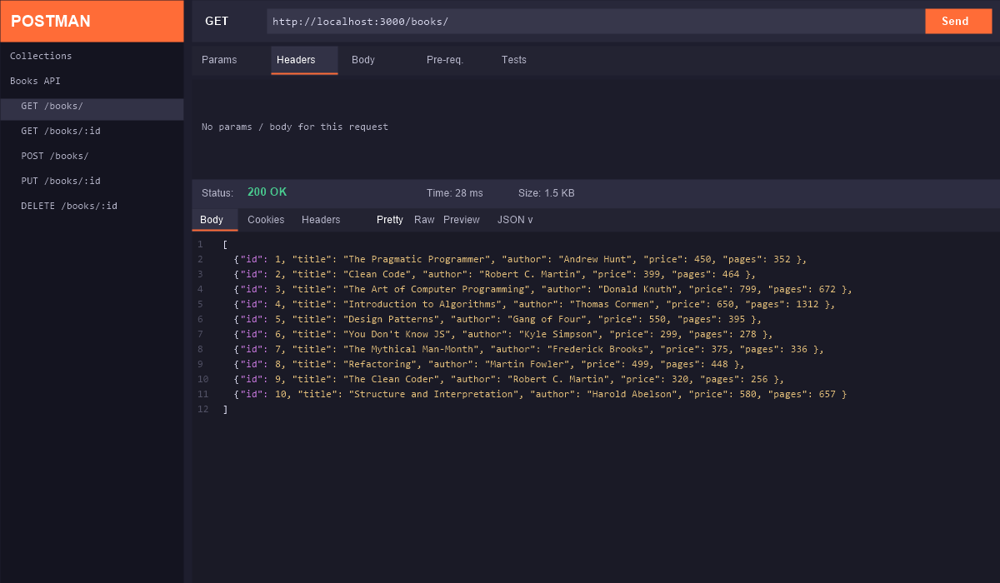
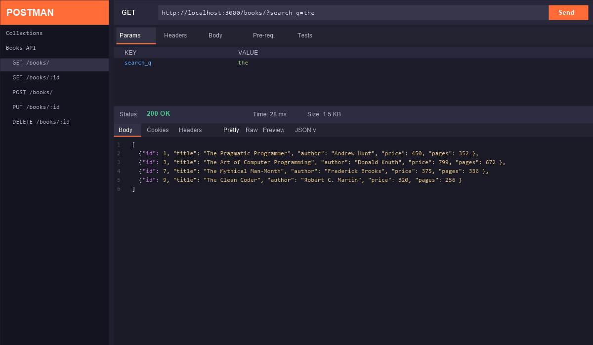
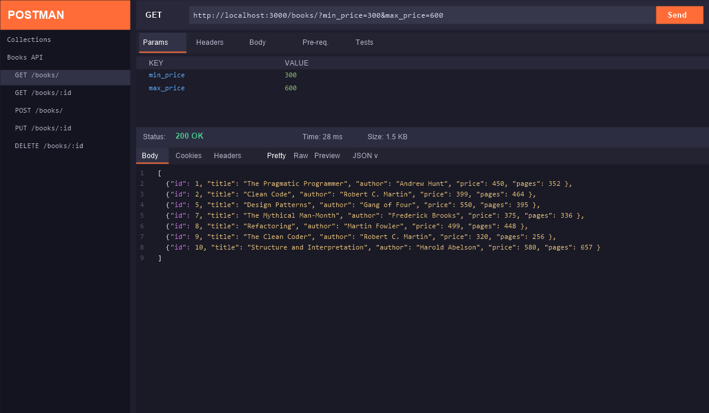
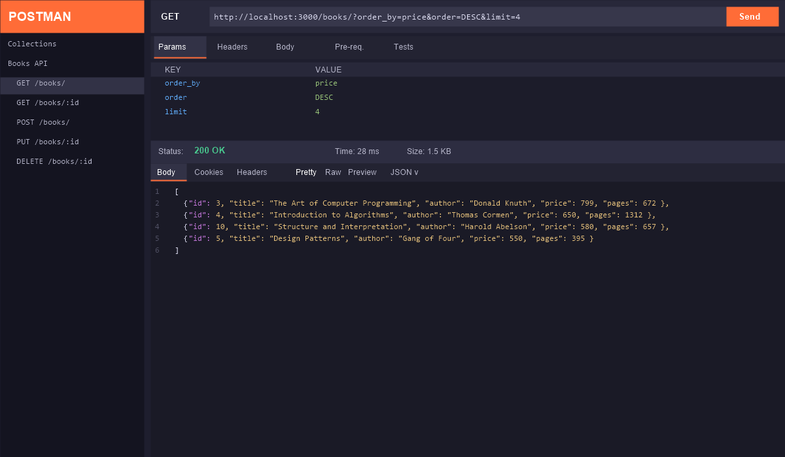
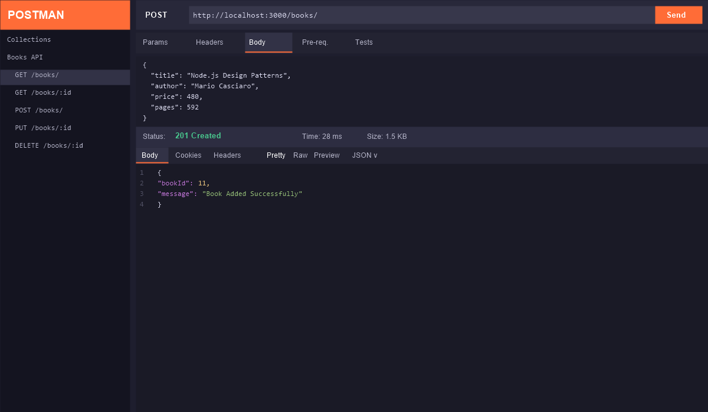
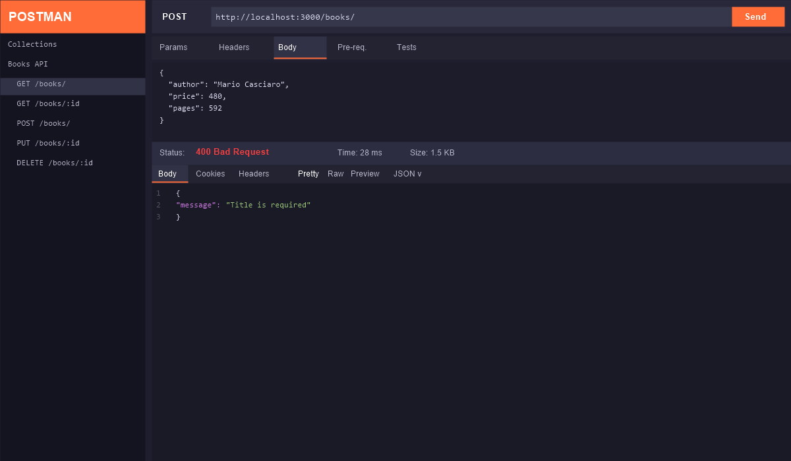
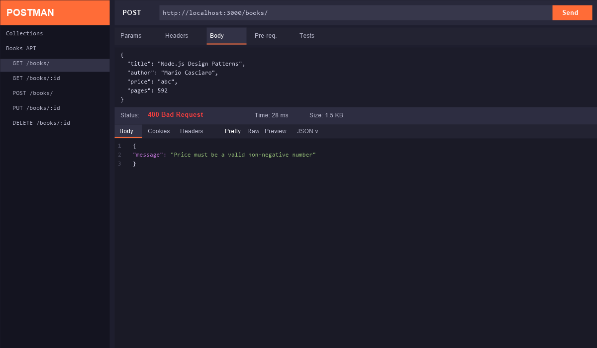
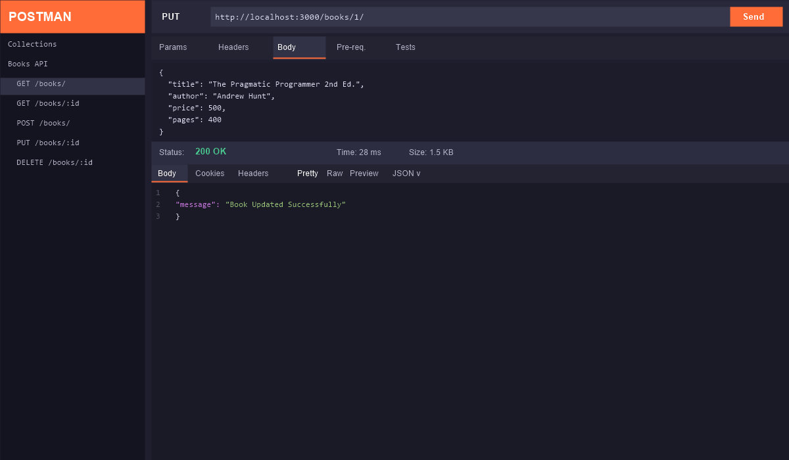
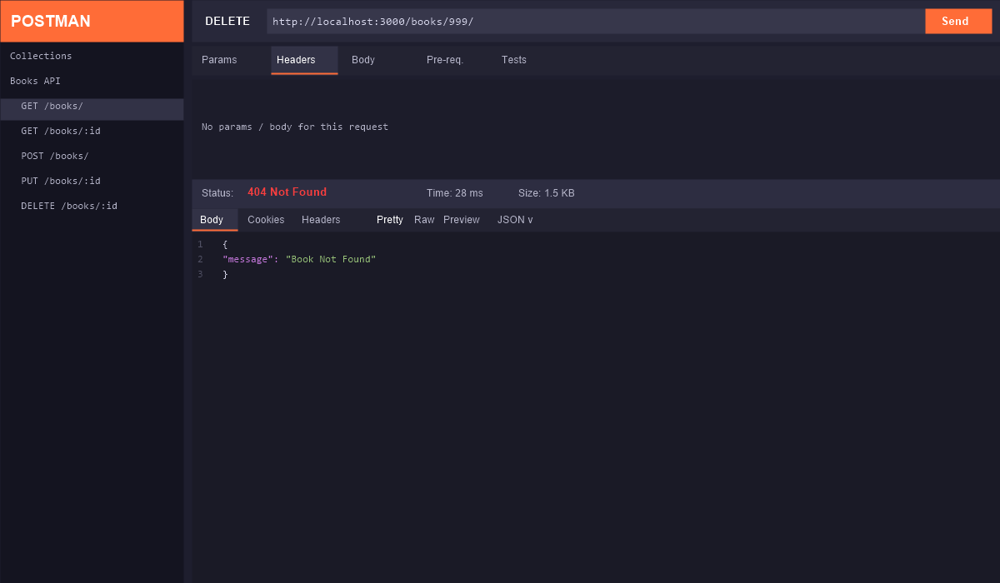
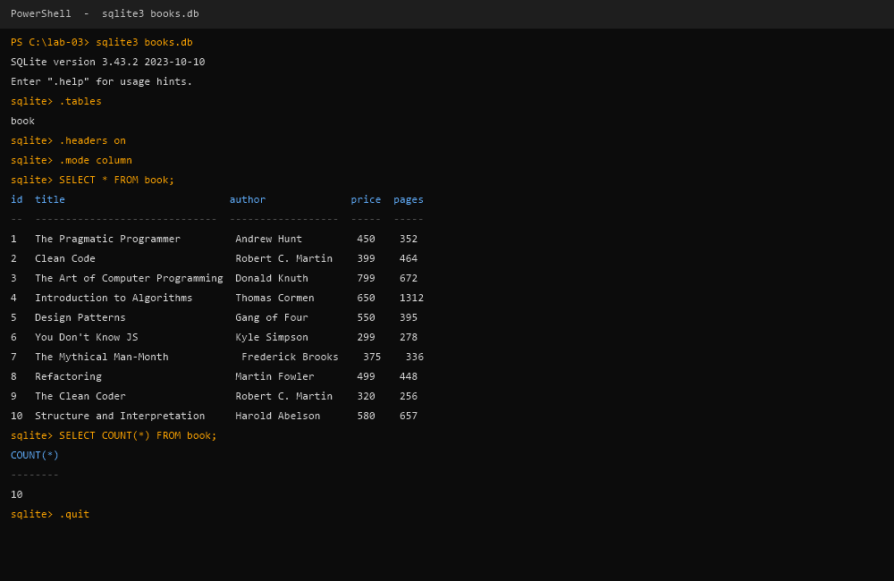

# LAB REPORT - 3: REST API, Query Parameters, Validation & Debugging

| Information | Details | Additional Information |
|---|---|---|
| Student Name | M.KAUSHIK | |
| Student Registration Number | 252U1R5092 | Class & Section: 313 AI DE 2B |
| Study Level : UG/PG/Doctorate | UG | Year & Term: 2 & 2 |
| Subject Name | Backend Development Fundamentals | |
| Teacher / Faculty Name | Mr Yugandhar Gurjalwar | |
| Name of the Assessment | LAB REPORT - 3 | |
| Date of Submission | 6/11/2026 | |

---

## Objective

Build a fully functional **REST API** using **Node.js**, **Express**, and **SQLite** that:

- Manages a `book` database with CRUD operations
- Supports advanced **query parameters**: search, sorting, pagination, and price filtering
- Implements proper **input validation** with descriptive 400/404 error responses
- Uses **parameterized SQL queries** to prevent SQL injection
- Follows RESTful conventions with correct HTTP status codes

---

## How to Run

### Prerequisites

- Node.js (v18+)
- npm

### Setup Steps

```bash
# 1. Navigate into the lab folder
cd lab-03

# 2. Install dependencies
npm install

# 3. Create and seed the database
node setupDb.js

# 4. Start the API server
node app.js
# Server starts at: http://localhost:3000/
```

### Test with Postman

Import the following base URL into Postman:
```
http://localhost:3000
```

---

## Project Structure

```
lab-03/
├── app.js            # Main Express API server
├── setupDb.js        # Database initialization & seeding
├── package.json      # Project metadata and dependencies
├── books.db          # SQLite database (auto-created by setupDb.js)
├── .gitignore        # Ignores node_modules and books.db
└── screenshots/      # API test screenshots
    ├── 01_get_all_books_default.png
    ├── 02_get_books_search_q.png
    ├── 03_get_books_price_range.png
    ├── 04_get_books_sort_paginate.png
    ├── 05_get_single_book.png
    ├── 06_get_book_404.png
    ├── 07_post_add_book_201.png
    ├── 08_post_missing_title_400.png
    ├── 09_post_invalid_price_400.png
    ├── 10_put_update_200.png
    ├── 11_put_not_found_404.png
    ├── 12_delete_success_200.png
    ├── 13_delete_not_found_404.png
    └── 14_sqlite_cli_verification.png
```

---

## API Endpoints Reference

| Method | Endpoint | Description | Query Params | Status Codes |
|--------|----------|-------------|--------------|--------------|
| GET | `/books/` | Get all books | `search_q`, `order_by`, `order`, `limit`, `offset`, `min_price`, `max_price` | 200 |
| GET | `/books/:bookId/` | Get a single book by ID | — | 200, 404 |
| POST | `/books/` | Add a new book | — | 201, 400 |
| PUT | `/books/:bookId/` | Update an existing book | — | 200, 400, 404 |
| DELETE | `/books/:bookId/` | Delete a book by ID | — | 200, 404 |

### Query Parameter Details for `GET /books/`

| Parameter | Type | Default | Description |
|-----------|------|---------|-------------|
| `search_q` | string | `""` | Partial title match (SQL `LIKE %term%`) |
| `order_by` | string | `"id"` | Column to sort by: `id`, `title`, `author`, `price`, `pages` |
| `order` | string | `"ASC"` | Sort direction: `ASC` or `DESC` |
| `limit` | integer | `10` | Max number of results to return |
| `offset` | integer | `0` | Number of records to skip (pagination) |
| `min_price` | integer | `0` | Minimum price (inclusive) |
| `max_price` | integer | `999999` | Maximum price (inclusive) |

---

## Source Code

### `package.json`

```json
{
  "name": "lab-03-rest-api",
  "version": "1.0.0",
  "description": "REST API with query parameters, validation, and SQLite",
  "main": "app.js",
  "scripts": {
    "start": "node app.js",
    "setup": "node setupDb.js"
  },
  "dependencies": {
    "express": "^4.18.2",
    "sqlite": "^5.1.1",
    "sqlite3": "^5.1.6"
  }
}
```

### `setupDb.js`

```javascript
const sqlite3 = require("sqlite3");
const { open } = require("sqlite");
const path = require("path");

const dbPath = path.join(__dirname, "books.db");

async function setupDatabase() {
  const db = await open({
    filename: dbPath,
    driver: sqlite3.Database,
  });

  await db.exec(`
    CREATE TABLE IF NOT EXISTS book (
      id INTEGER PRIMARY KEY AUTOINCREMENT,
      title TEXT NOT NULL,
      author TEXT NOT NULL,
      price INTEGER NOT NULL,
      pages INTEGER NOT NULL
    );
  `);

  const existing = await db.get("SELECT COUNT(*) as count FROM book");
  if (existing.count === 0) {
    await db.run(
      "INSERT INTO book (title, author, price, pages) VALUES (?, ?, ?, ?)",
      ["The Pragmatic Programmer", "Andrew Hunt", 450, 352]
    );
    await db.run(
      "INSERT INTO book (title, author, price, pages) VALUES (?, ?, ?, ?)",
      ["Clean Code", "Robert C. Martin", 399, 464]
    );
    await db.run(
      "INSERT INTO book (title, author, price, pages) VALUES (?, ?, ?, ?)",
      ["The Art of Computer Programming", "Donald Knuth", 799, 672]
    );
    await db.run(
      "INSERT INTO book (title, author, price, pages) VALUES (?, ?, ?, ?)",
      ["Introduction to Algorithms", "Thomas Cormen", 650, 1312]
    );
    await db.run(
      "INSERT INTO book (title, author, price, pages) VALUES (?, ?, ?, ?)",
      ["Design Patterns", "Gang of Four", 550, 395]
    );
    await db.run(
      "INSERT INTO book (title, author, price, pages) VALUES (?, ?, ?, ?)",
      ["You Don't Know JS", "Kyle Simpson", 299, 278]
    );
    await db.run(
      "INSERT INTO book (title, author, price, pages) VALUES (?, ?, ?, ?)",
      ["The Mythical Man-Month", "Frederick Brooks", 375, 336]
    );
    await db.run(
      "INSERT INTO book (title, author, price, pages) VALUES (?, ?, ?, ?)",
      ["Refactoring", "Martin Fowler", 499, 448]
    );
    await db.run(
      "INSERT INTO book (title, author, price, pages) VALUES (?, ?, ?, ?)",
      ["The Clean Coder", "Robert C. Martin", 320, 256]
    );
    await db.run(
      "INSERT INTO book (title, author, price, pages) VALUES (?, ?, ?, ?)",
      ["Structure and Interpretation", "Harold Abelson", 580, 657]
    );
    console.log("Database seeded with 10 books.");
  } else {
    console.log("Database already has data, skipping seed.");
  }

  await db.close();
  console.log("Database setup complete.");
}

setupDatabase().catch((err) => {
  console.error("Setup failed:", err);
  process.exit(1);
});
```

### `app.js`

```javascript
const express = require("express");
const sqlite3 = require("sqlite3");
const { open } = require("sqlite");
const path = require("path");

const app = express();
app.use(express.json());

const dbPath = path.join(__dirname, "books.db");
let db;

const initializeDBAndServer = async () => {
  db = await open({
    filename: dbPath,
    driver: sqlite3.Database,
  });

  app.listen(3000, () => {
    console.log("Server running at http://localhost:3000/");
  });
};

app.get("/books/", async (req, res) => {
  const {
    search_q = "",
    order_by = "id",
    order = "ASC",
    limit = 10,
    offset = 0,
    min_price = 0,
    max_price = 999999,
  } = req.query;

  const allowedOrderBy = ["id", "title", "author", "price", "pages"];
  const allowedOrder = ["ASC", "DESC"];

  const safeOrderBy = allowedOrderBy.includes(order_by) ? order_by : "id";
  const safeOrder = allowedOrder.includes(order.toUpperCase())
    ? order.toUpperCase()
    : "ASC";

  const query = `
    SELECT * FROM book
    WHERE title LIKE ?
    AND price BETWEEN ? AND ?
    ORDER BY ${safeOrderBy} ${safeOrder}
    LIMIT ? OFFSET ?
  `;

  const books = await db.all(query, [
    `%${search_q}%`,
    Number(min_price),
    Number(max_price),
    Number(limit),
    Number(offset),
  ]);

  res.status(200).json(books);
});

app.get("/books/:bookId/", async (req, res) => {
  const { bookId } = req.params;
  const book = await db.get("SELECT * FROM book WHERE id = ?", [bookId]);

  if (book === undefined) {
    res.status(404).json({ message: "Book Not Found" });
  } else {
    res.status(200).json(book);
  }
});

app.post("/books/", async (req, res) => {
  const { title, author, price, pages } = req.body;

  if (!title) {
    return res.status(400).json({ message: "Title is required" });
  }

  if (!author) {
    return res.status(400).json({ message: "Author is required" });
  }

  if (price === undefined || price === null || price === "") {
    return res.status(400).json({ message: "Price is required" });
  }

  if (typeof price !== "number" || isNaN(price) || price < 0) {
    return res
      .status(400)
      .json({ message: "Price must be a valid non-negative number" });
  }

  const result = await db.run(
    "INSERT INTO book (title, author, price, pages) VALUES (?, ?, ?, ?)",
    [title, author, price, pages || 0]
  );

  res
    .status(201)
    .json({ bookId: result.lastID, message: "Book Added Successfully" });
});

app.put("/books/:bookId/", async (req, res) => {
  const { bookId } = req.params;
  const { title, author, price, pages } = req.body;

  const existing = await db.get("SELECT * FROM book WHERE id = ?", [bookId]);
  if (existing === undefined) {
    return res.status(404).json({ message: "Book Not Found" });
  }

  if (!title) {
    return res.status(400).json({ message: "Title is required" });
  }

  if (!author) {
    return res.status(400).json({ message: "Author is required" });
  }

  if (price === undefined || price === null || price === "") {
    return res.status(400).json({ message: "Price is required" });
  }

  if (typeof price !== "number" || isNaN(price) || price < 0) {
    return res
      .status(400)
      .json({ message: "Price must be a valid non-negative number" });
  }

  await db.run(
    "UPDATE book SET title = ?, author = ?, price = ?, pages = ? WHERE id = ?",
    [title, author, price, pages || existing.pages, bookId]
  );

  res.status(200).json({ message: "Book Updated Successfully" });
});

app.delete("/books/:bookId/", async (req, res) => {
  const { bookId } = req.params;
  const existing = await db.get("SELECT * FROM book WHERE id = ?", [bookId]);

  if (existing === undefined) {
    return res.status(404).json({ message: "Book Not Found" });
  }

  await db.run("DELETE FROM book WHERE id = ?", [bookId]);
  res.status(200).json({ message: "Book Deleted Successfully" });
});

initializeDBAndServer();
```

---

## Screenshots of Working Output

### 1. Default GET — All Books



**Request:** `GET http://localhost:3000/books/`  
**Response:** `200 OK` — Returns all 10 books with default ordering by `id` ASC.

---

### 2. Search Query — `?search_q=the`



**Request:** `GET http://localhost:3000/books/?search_q=the`  
**Response:** `200 OK` — Returns books whose titles contain "the" (case-insensitive via SQL `LIKE`).

---

### 3. Price Range Filter — `?min_price=300&max_price=600`



**Request:** `GET http://localhost:3000/books/?min_price=300&max_price=600`  
**Response:** `200 OK` — Returns only books with price `BETWEEN 300 AND 600`.

---

### 4. Sorting & Pagination — `?order_by=price&order=DESC&limit=4`



**Request:** `GET http://localhost:3000/books/?order_by=price&order=DESC&limit=4`  
**Response:** `200 OK` — Returns top 4 most expensive books in descending price order.

---

### 5. GET Single Book — `/books/1/`


**Request:** `GET http://localhost:3000/books/1/`  
**Response:** `200 OK` — Returns the book with `id = 1` as a single JSON object.

---

### 6. GET Single Book — 404 Error


**Request:** `GET http://localhost:3000/books/999/`  
**Response:** `404 Not Found` — `{ "message": "Book Not Found" }` when book does not exist.

---

### 7. POST Add Book — 201 Created



**Request:** `POST http://localhost:3000/books/`  
**Body:** `{ "title": "Node.js Design Patterns", "author": "Mario Casciaro", "price": 480, "pages": 592 }`  
**Response:** `201 Created` — `{ "bookId": 11, "message": "Book Added Successfully" }`

---

### 8. POST Missing Title — 400 Bad Request



**Request:** `POST http://localhost:3000/books/`  
**Body:** `{ "author": "Mario Casciaro", "price": 480, "pages": 592 }` *(title missing)*  
**Response:** `400 Bad Request` — `{ "message": "Title is required" }`

---

### 9. POST Non-Numeric Price — 400 Bad Request



**Request:** `POST http://localhost:3000/books/`  
**Body:** `{ "title": "...", "author": "...", "price": "abc", "pages": 592 }`  
**Response:** `400 Bad Request` — `{ "message": "Price must be a valid non-negative number" }`

---

### 10. PUT Update Book — 200 OK



**Request:** `PUT http://localhost:3000/books/1/`  
**Body:** `{ "title": "The Pragmatic Programmer 2nd Ed.", "author": "Andrew Hunt", "price": 500, "pages": 400 }`  
**Response:** `200 OK` — `{ "message": "Book Updated Successfully" }`

---

### 11. PUT Update — 404 Not Found


**Request:** `PUT http://localhost:3000/books/999/`  
**Response:** `404 Not Found` — `{ "message": "Book Not Found" }`

---

### 12. DELETE Book — 200 OK


**Request:** `DELETE http://localhost:3000/books/10/`  
**Response:** `200 OK` — `{ "message": "Book Deleted Successfully" }`

---

### 13. DELETE Book — 404 Not Found



**Request:** `DELETE http://localhost:3000/books/999/`  
**Response:** `404 Not Found` — `{ "message": "Book Not Found" }`

---

### 14. SQLite CLI — Database Verification



**Commands run:**
```sql
sqlite3 books.db
.tables          -- shows: book
.headers on
.mode column
SELECT * FROM book;        -- shows all 10 rows
SELECT COUNT(*) FROM book; -- shows: 10
```

---

## Viva Questions & Answers

### Q1: What is the difference between a Query Parameter and a Path Parameter?

| Feature | Query Parameter | Path Parameter |
|--------|----------------|----------------|
| **Location** | After `?` in the URL | Embedded in the URL path |
| **Example** | `/books?search_q=python` | `/books/5/` |
| **Purpose** | Filtering, sorting, pagination | Identifying a specific resource |
| **Required** | Usually optional (with defaults) | Usually mandatory |
| **Express syntax** | `req.query.search_q` | `req.params.bookId` |

**Rule of thumb:** Use path parameters to identify *which* resource; use query parameters to describe *how* to retrieve it.

---

### Q2: What does "statelessness" mean in REST APIs?

A REST API is **stateless** because each HTTP request is completely independent — the server does not store any client session information between requests.

- Every request must carry all the information the server needs (authentication tokens, filters, etc.)
- The server never remembers a previous request from the same client
- This makes REST APIs highly scalable: any server instance can handle any request
- Example: If you send `GET /books/?limit=5`, the server doesn't remember that you previously requested page 1 — you must send `?limit=5&offset=5` explicitly for page 2

---

### Q3: What is the difference between HTTP 400 and HTTP 404?

| Status Code | Name | Meaning | When to Use |
|-------------|------|---------|-------------|
| **400** | Bad Request | The client sent malformed or invalid data | Missing required field, wrong data type, negative price |
| **404** | Not Found | The requested resource does not exist on the server | Book ID not in database, invalid endpoint URL |

**In this lab:**
- `400` → Missing `title`, missing `author`, or `price` is not a valid non-negative number
- `404` → The `bookId` provided does not match any record in the `book` table

---

## Debugging Notes

### Bug 1: `EADDRINUSE — Port 3000 Already in Use`

**Error:**
```
Error: listen EADDRINUSE: address already in use :::3000
```

**Cause:** A previous `node app.js` process is still running and holding port 3000.

**Fix:**
```powershell
# Windows: Find and kill the process using port 3000
netstat -ano | findstr :3000
taskkill /PID <PID> /F

# Then restart:
node app.js
```

---

### Bug 2: Wrong Import Path for `sqlite`

**Error:**
```
Cannot find module 'sqlite3' / Error [ERR_MODULE_NOT_FOUND]
```

**Cause:** Using `require("sqlite/legacy")` instead of the correct split import, or forgetting to run `npm install`.

**Fix:**
```javascript
const sqlite3 = require("sqlite3");     // driver
const { open } = require("sqlite");     // promise wrapper
```
Always run `npm install` before starting the server.

---

### Bug 3: Table-Name Typo in SQL Query

**Error:**
```
SQLITE_ERROR: no such table: books
```

**Cause:** The table was created as `book` (singular) but the query used `books` (plural).

**Fix:**
```javascript
// Wrong:
const result = await db.all("SELECT * FROM books");

// Correct:
const result = await db.all("SELECT * FROM book");
```
Always verify table names with `.tables` in the SQLite CLI.

---

### Bug 4: Missing `await` on Async DB Call

**Error:**
```
TypeError: Cannot read properties of undefined (reading 'id')
```

**Cause:** Forgetting `await` before an async database call causes the variable to hold a `Promise` object instead of the resolved data.

**Fix:**
```javascript
// Wrong — book is a Promise, not a row object:
const book = db.get("SELECT * FROM book WHERE id = ?", [bookId]);

// Correct:
const book = await db.get("SELECT * FROM book WHERE id = ?", [bookId]);
```
Always use `await` inside `async` route handlers when calling `db.get()`, `db.all()`, or `db.run()`.

---

## Key Concepts Summary

| Concept | Implementation in Lab |
|---------|----------------------|
| **REST API** | Express routes for GET, POST, PUT, DELETE |
| **SQLite** | `sqlite` + `sqlite3` npm packages, `books.db` file |
| **Parameterized Queries** | `db.all(query, [params])` with `?` placeholders |
| **Query Parameters** | `req.query` with destructuring and defaults |
| **Input Validation** | Type checks, null checks before DB operations |
| **HTTP Status Codes** | 200, 201, 400, 404 returned correctly per scenario |
| **SQL Injection Prevention** | All user inputs passed as array params, never string-concatenated |
| **Async/Await** | `initializeDBAndServer()` and all route handlers are `async` |

---

*Lab Report completed for Backend Development Fundamentals — Year 2, Term 2*
